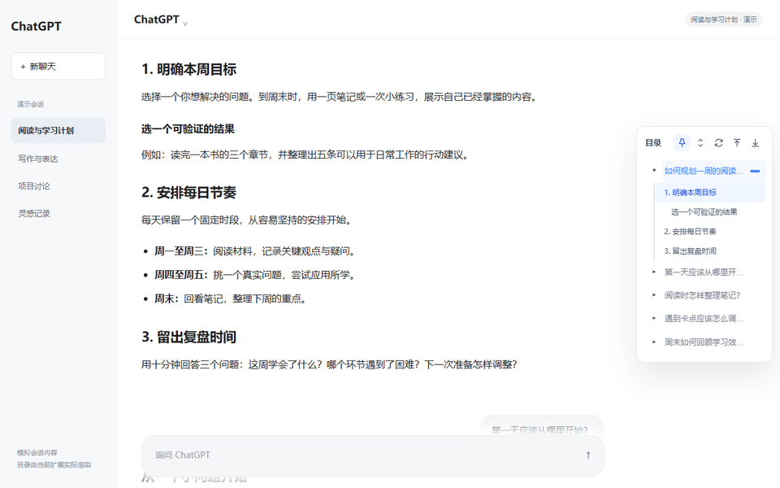
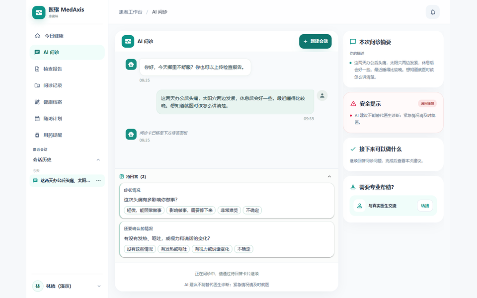
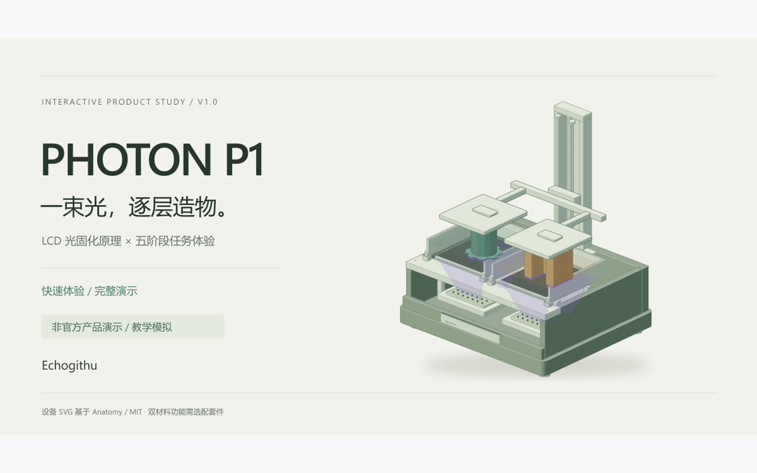
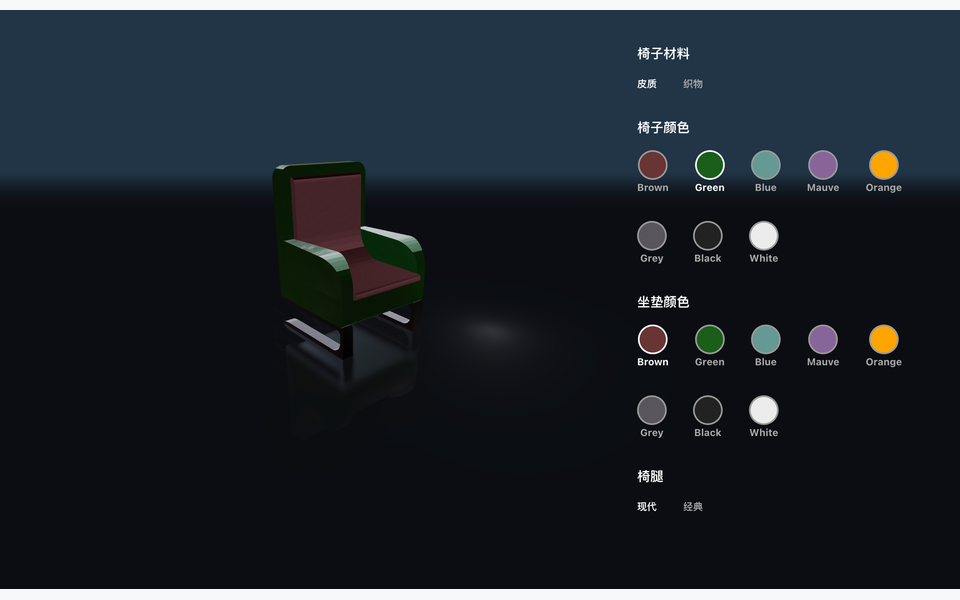
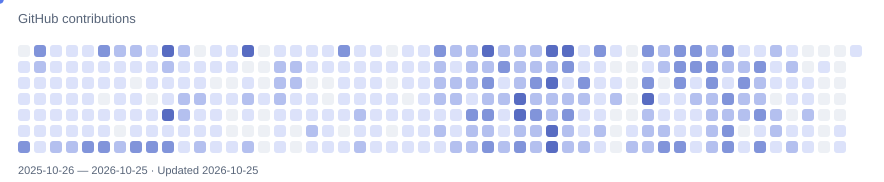

<strong>English</strong> · <a href="./README.zh-CN.md">简体中文</a>

<picture>
  <source media="(max-width: 600px)" srcset="https://raw.githubusercontent.com/Echogithu/Echogithu/596a8449ac4d39b4ec0a072f599e51f5a6ce9be9/assets/header-mobile.svg">
  
</picture>

### 👋 Hi, I'm Echo

I turn everyday problems into practical tools, with a focus on **AI applications, full-stack development, and workflow automation**.

Exploring the full journey from interfaces and APIs to AI capabilities, turning ideas into useful products.

[Projects](#-featured-projects) · [Learning](#-learning--resources) · [Repositories](https://github.com/Echogithu?tab=repositories)

## 🚀 Featured Projects

<table>
<tr>
<td width="50%" valign="top">

<h3>ChatGPT Outline</h3>

A table of contents for long conversations. Jump back to questions and answer sections.

<code>JavaScript</code> <code>Browser Extension</code>

<a href="https://github.com/Echogithu/ChatGPT-Outline-Public">Install Locally ↗</a>

</td>
<td width="50%" valign="top">

<h3>MedAxis</h3>

AI-assisted healthcare collaboration around medical documents, case records, and follow-up.

<code>React</code> <code>FastAPI</code>

<a href="https://github.com/Echogithu/medaxis">View Project ↗</a>

In development. AI helps organize information; it does not replace clinical diagnosis or treatment. Screenshot uses synthetic data.
</td>
</tr>
<tr>
<td width="50%" valign="top">

<h3>Photon P1 Demo</h3>

An interactive explanation of resin printing and a five-stage task workflow.

<code>HTML</code> <code>SVG</code> <code>Interactive Learning</code>

<a href="https://echogithu.github.io/photon-p1-demo/">Live Demo ↗</a> · <a href="https://github.com/Echogithu/photon-p1-demo">Source</a>

Unofficial educational simulation. Does not control real hardware.
</td>
<td width="50%" valign="top">

<h3>3D Product Configurator</h3>

Exploring product presentation and configuration through interactive 3D in the browser.

<code>React</code> <code>Three.js</code>

<a href="https://echogithu.github.io/chair-configurator/">Live Demo ↗</a> · <a href="https://github.com/Echogithu/chair-configurator">Source</a>

</td>
</tr>
</table>

## 🧪 Currently Exploring

- **AI workflows**: Bringing agents, skills, and personal knowledge together to support real tasks.
- **Product interaction**: Making complex tools easier to use through clear interfaces and hands-on demos.
- **Full-stack practice**: Connecting interfaces, APIs, data, and AI—from requirements and implementation to validation.

## 🛠 Tech & Tools

  
  
  
  
  
  
  
  

## 📚 Learning & Resources

| Resource | Focus |
| --- | --- |
| [AI-Command-Center](https://github.com/Echogithu/AI-Command-Center) (Private) | My AI workflow: organizing agents, skills, rules, and knowledge. |
| [study-notes](https://github.com/Echogithu/study-notes) (Private) | Personal learning notes, practical experience, and reflections. |
| [build-my-own-tools](https://github.com/Echogithu/build-my-own-tools) | Learning by building—from EventEmitter and deep cloning to a template loader. |
| [Refactoring Examples](https://github.com/Echogithu/Refactoring-Improving-the-Design-of-Existing-Code) | Examples related to <em>Refactoring: Improving the Design of Existing Code</em>. |

## 🐍 Contribution Trail

<picture>
  <source media="(prefers-reduced-motion: reduce) and (prefers-color-scheme: dark)" srcset="./assets/contributions-static-dark.svg">
  <source media="(prefers-reduced-motion: reduce)" srcset="./assets/contributions-static.svg">
  <source media="(prefers-color-scheme: dark)" srcset="./assets/contributions-dark.svg">
  
</picture>

Build useful things. Keep learning.

